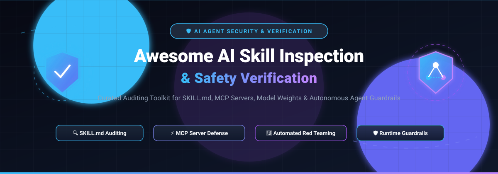

# 🛡️ Awesome AI Skill Inspection &amp; Safety Verification

### *Auditing AI Agent Skills (`SKILL.md`), Model Context Protocol (MCP) Servers, Model Supply Chains &amp; Autonomous Runtime Guardrails*

  
  
  
  
  
  
  

**A battle-tested, curated index of enterprise SaaS platforms and leading open-source GitHub frameworks for auditing, verifying, and red-teaming AI agent capability packs (`SKILL.md`), tool definitions, Model Context Protocol (MCP) servers, model weights, and multi-agent workflows.**

*Last updated: November 2026*

---

## 📑 Table of Contents

- [🌐 Sector Overview &amp; Market Dynamics](#-sector-overview--market-dynamics)
- [🏢 SaaS &amp; Hosted Platforms](#-saas--hosted-platforms)
- [💻 Open-Source GitHub Projects](#-open-source-github-projects)
- [🤝 How to Contribute](#-how-to-contribute)
- [☕ Support &amp; Sponsor](#-support--sponsor)
- [📈 Star History](#-star-history)
- [⚠️ Disclaimer](#️-disclaimer)

---

## 🌐 Sector Overview &amp; Market Dynamics

The global market for **AI Security, AI-SPM (Security Posture Management), and Trust, Risk &amp; Security Management (AI TRiSM)** is estimated at **$13.2B to $31B**, projected to surpass **$86B to $95B by 2034** at an accelerating **22% to 29% CAGR**. 

Market concentration remains **highly fragmented** rather than winner-take-all: the attack surface rapidly shifts from prompt injection firewalls to serialized model weights (`pickle`/safetensors) and autonomous agent extensions (`SKILL.md` instruction tampering and Model Context Protocol schema hijacks), spurring specialized point solutions and targeted acquisitions by enterprise giants (such as Cisco acquiring Robust Intelligence and Snyk acquiring Invariant Labs).

---

## 🏢 SaaS &amp; Hosted Platforms

The following enterprise platforms provide managed, hosted, and cloud-native solutions for AI red-teaming, runtime safety firewalls, skill inspection, and AI supply-chain security. Platforms are sorted in descending order by parent company scale (valuation / annual revenue).

| Platform / Vendor | Company Scale (Valuation / Revenue) 📊 | Pricing (Starting Tier) 💳 | Free Tier Limits / Free Trial 🎁 | Core Inspection &amp; Safety Focus 🛡️ |
| :--- | :--- | :--- | :--- | :--- |
| **[Cisco AI Defense](https://cisco.com)** *(formerly Robust Intelligence)* | **$230B Market Cap** *(Acquired for $400M)* | **$12,000/year** *(starting enterprise validation tier; custom quote on AWS Marketplace)* | **14-day guided proof-of-concept trial** *(includes custom model assessment &amp; algorithmic red-teaming benchmark)* | Enterprise AI validation, algorithmic red-teaming, supply-chain verification, and real-time runtime guardrails. |
| **[Fiddler AI](https://fiddler.ai)** *(CrowdStrike AI Defense)* | **$400M Valuation** *(Acquired by CrowdStrike, $80B+ Market Cap)* | **$30,000/year** *(enterprise monitoring package; custom quote based on model volume)* | **30-day enterprise evaluation trial** *(includes full LLM guardrails, agent tracing, and drift detection sandbox)* | Enterprise AI observability, sub-100ms safety &amp; jailbreak guardrails, PII masking, and multi-agent tracing. |
| **[HiddenLayer](https://hiddenlayer.com)** | **$383M Valuation** *(Forge Global estimate, $56M+ funding)* | **$10,000/year** *(base entry tier on AWS / Azure Marketplace via private contract)* | **14-day sandbox trial** *(automated ML model scanner for up to 5 model artifacts upon sales qualification)* | MLDR (Machine Learning Detection &amp; Response), adversarial attack detection, model integrity scanning, and red-teaming. |
| **[Protect AI](https://protectai.com)** *(Guardian &amp; Layer)* | **$350M Valuation** *($108.5M+ funding across Series B)* | **$1,500/month** *($18,000/year base platform subscription; custom AWS contract)* | **Free Open-Source Scanners** *(unlimited local scans via `modelscan` &amp; `llm-guard`) + **14-day hosted trial** upon demo request* | AI-SPM platform, model artifact supply-chain scanning, real-time prompt firewalling (`Layer`), and threat research via Huntr. |
| **[Arthur AI](https://arthur.ai)** *(Arthur Shield)* | **$140M Valuation** *($60M+ venture funding)* | **$60/month** *(Arthur Premium plan; billed annually or monthly)* | **Free for life plan** *(supports up to 4 production use cases, 7-day data retention, unlimited seats)* | Real-time LLM firewall, prompt injection &amp; hallucination scoring, PII redaction, and behavioral safety guardrails. |
| **[Mindgard](https://mindgard.ai)** | **$120M Valuation** *($42M venture capital funding)* | **$1,000/month** *($12,000/year starting team subscription; billed annually)* | **Free forever plan (Mindgard AI Security Labs)** *(unlimited access to 170+ red-team attack scenarios; no CC required)* | Continuous automated AI red-teaming, jailbreak probing, excessive agency detection, and agent tool-use exploit auditing. |
| **[Lakera Guard](https://lakera.ai)** | **$90M Valuation** *($30M total funding)* | **$250/month** *(Developer Pro plan for commercial throughput; custom Enterprise)* | **Free forever Community plan** *(up to 10,000 requests/month, 8,000 tokens per prompt, full dashboard &amp; API access)* | Ultra-low-latency runtime AI security firewall protecting LLM apps and tool-calling agents against injections and jailbreaks. |
| **[Patronus AI](https://patronus.ai)** | **$75M Valuation** *($20M venture capital funding)* | **$25/month** *(Base Developer plan; evaluator API usage at ~$10/1k calls)* | **Free developer workspace** *(complimentary trial API credits, evaluation playground, up to 100 test runs/month)* | Automated AI evaluation, hallucination detection, custom automated adversarial test generation, and compliance verification. |
| **[Invariant Labs](https://invariantlabs.ai)** *(Snyk AI Security)* | **$65M Valuation** *(Acquired by Snyk, $7.4B Market Cap)* | **$25/month/user** *(via Snyk Team subscription; custom Enterprise platform tiers)* | **Free Snyk developer plan** *(includes free static analysis scans &amp; open-source `mcp-scan` security analyzer)* | Agentic AI security, Model Context Protocol (MCP) auditing, tool-call policy enforcement, and supply-chain threat detection. |
| **[Vigil AI](https://promptfoo.dev)** *(Promptfoo Cloud / Enterprise)* | **$45M Valuation** *($15M funding led by Andreessen Horowitz)* | **$49/month** *(Vigil base plan; Promptfoo hosted cloud starting tier)* | **Free open-source CLI forever** *(unlimited local evaluations and up to 10,000 red-team probes/month free)* | Continuous enterprise red-teaming, OWASP Top 10 for LLMs testing, skill verification, and automated CI/CD gating. |

---

## 💻 Open-Source GitHub Projects

Explore the most popular open-source repositories for auditing AI skills, scanning MCP servers, conducting automated red teaming, and enforcing runtime guardrails. 

*Repositories are sorted in descending order by GitHub Stars_Count.*

| Repository | Stars_Badge | Key Capabilities &amp; Verification Focus | License |
| :--- | :---: | :--- | :--- |
| **[promptfoo/promptfoo](https://github.com/promptfoo/promptfoo)** |  | CLI &amp; evaluation harness featuring automated red-teaming (`promptfoo redteam`) for CI/CD gating of prompts, skills, and agents against OWASP LLM Top 10 vulnerabilities. | `MIT` |
| **[NVIDIA/SkillSpector](https://github.com/NVIDIA/SkillSpector)** |  | Flagship toolkit for statically and dynamically auditing AI agent capability packs (`SKILL.md`) and extension scripts for prompt injection payloads, privilege escalation, and unsafe tool usage. | `Apache-2.0` |
| **[semgrep/semgrep](https://github.com/semgrep/semgrep)** |  | Lightweight static analysis engine widely adopted in agent security pipelines to audit Python, TypeScript, and Bash helper scripts bundled inside third-party skill packages. | `LGPL-2.1` |
| **[open-policy-agent/opa](https://github.com/open-policy-agent/opa)** |  | Declarative policy engine (`Rego`) integrated with MCP gateways and autonomous agent runtimes to verify, authorize, and enforce least-privilege tool execution policies. | `Apache-2.0` |
| **[NVIDIA/garak](https://github.com/NVIDIA/garak)** |  | Industry-standard generative AI vulnerability scanner probing model endpoints for prompt injections, jailbreaks, encoding bypasses, data exfiltration, and toxic generation. | `Apache-2.0` |
| **[VirusTotal/yara](https://github.com/VirusTotal/yara)** |  | Pattern-matching Swiss Army knife used by skill scanners to identify known malicious payload signatures, encoded shell commands, and evasion strings in agent directories. | `BSD-3-Clause` |
| **[guardrails-ai/guardrails](https://github.com/guardrails-ai/guardrails)** |  | Framework and validator hub for enforcing structural, semantic, PII, hallucination, and behavioral verification checks on LLM agent inputs and outputs. | `Apache-2.0` |
| **[NVIDIA/NeMo-Guardrails](https://github.com/NVIDIA/NeMo-Guardrails)** |  | Programmable guardrail runtime using Colang to verify and enforce topical constraints, safety policies, jailbreak defense, and deterministic tool authorization on agentic systems. | `Apache-2.0` |
| **[Giskard-AI/giskard](https://github.com/Giskard-AI/giskard)** |  | Automated QA and safety verification platform for LLM applications, testing for prompt injection susceptibility, data leakage, and unexpected tool hallucinations. | `Apache-2.0` |
| **[google-deepmind/gemma](https://github.com/google-deepmind/gemma)** |  | Open-weights repository hosting **ShieldGemma**, Google DeepMind's specialized safety classifier models designed to detect hate speech, harassment, sexually explicit content, and dangerous content. | `Apache-2.0` |
| **[microsoft/PyRIT](https://github.com/microsoft/PyRIT)** |  | Python Risk Identification Tool for generative AI from Microsoft's AI Red Team, automating multi-turn adversarial stress testing, adaptive jailbreaks, and scoring. | `MIT` |
| **[meta-llama/PurpleLlama](https://github.com/meta-llama/PurpleLlama)** |  | Open-source cybersecurity &amp; safety evaluation suite from Meta, containing `CyberSecEval` benchmarks, `Prompt Guard` injection classifiers, and `Llama Guard` input/output moderators. | `MIT` |
| **[UKGovernmentBEIS/inspect_ai](https://github.com/UKGovernmentBEIS/inspect_ai)** |  | High-assurance safety evaluation and verification framework developed by the UK AI Security Institute (AISI) for testing sandboxed tool use, cyber capabilities, and autonomous agency. | `MIT` |
| **[invariantlabs-ai/mcp-scan](https://github.com/invariantlabs-ai/mcp-scan)** |  | Specialized security scanner for Model Context Protocol (MCP) servers and tool endpoints, detecting schema poisoning, unauthorized capabilities, rug-pull updates, and data exfiltration flows. | `Apache-2.0` |
| **[protectai/llm-guard](https://github.com/protectai/llm-guard)** |  | Comprehensive, low-overhead security toolkit providing 30+ modular input/output scanners for prompt injection detection, PII anonymization, toxic language filtering, and secrets scanning. | `MIT` |
| **[confident-ai/deepteam](https://github.com/confident-ai/deepteam)** |  | Production-ready LLM red-teaming framework simulating 40+ adversarial attack vectors including excessive agency, Broken Object Level Authorization (BOLA), and prompt injections. | `Apache-2.0` |
| **[cisco-ai-defense/skill-scanner](https://github.com/cisco-ai-defense/skill-scanner)** |  | Static and semantic security scanner specifically crafted for AI agent skills (`SKILL.md` instructions and bundled executable scripts) combining AST flow analysis and LLM evaluation. | `Apache-2.0` |
| **[intel/cve-bin-tool](https://github.com/intel/cve-bin-tool)** |  | Binary vulnerability scanner widely deployed across AI container environments and agent sandboxes to detect known CVEs in native dependencies and compiled language wheels. | `GPL-3.0` |
| **[ethz-spylab/agentdojo](https://github.com/ethz-spylab/agentdojo)** |  | Dynamic evaluation benchmark from ETH Zurich measuring an AI agent's susceptibility to indirect prompt injection attacks hidden in external environments and retrieved documents. | `MIT` |
| **[protectai/modelscan](https://github.com/protectai/modelscan)** |  | AI supply-chain security scanner checking model checkpoints (`pickle`, `PyTorch`, `Keras`, `SavedModel`) for serialized code execution exploits before ingestion into agent pipelines. | `Apache-2.0` |
| **[deadbits/vigil-llm](https://github.com/deadbits/vigil-llm)** |  | Open-source prompt injection detection framework evaluating model prompts and agent inputs against vector databases of adversarial attacks and signature rules. | `Apache-2.0` |
| **[uiuc-kang-lab/InjecAgent](https://github.com/uiuc-kang-lab/InjecAgent)** |  | Benchmark dataset and verification suite assessing the vulnerability of tool-integrated AI agents to indirect prompt injections across diverse practical tool use cases. | `MIT` |
| **[microsoft/BIPIA](https://github.com/microsoft/BIPIA)** |  | Benchmark for Indirect Prompt Injection Attacks from Microsoft, systematically evaluating agent resilience against poisoned web pages and adversarial email contexts. | `MIT` |
| **[allenai/wildguard](https://github.com/allenai/wildguard)** |  | Open-source, multi-task safety moderation model by the Allen Institute for AI detecting adversarial prompts, harmful intent, and model refusal compliance. | `Apache-2.0` |

---

## 🤝 How to Contribute

We welcome contributions from the cybersecurity and AI safety engineering communities!

1. 🍴 **Fork the repository**
2. 🌿 **Create a new branch**: `git checkout -b feature/add-tool-name`
3. ✍️ **Add or update the listing**: Ensure SaaS entries include verified starting tier prices, specific free tier limits, and updated market sizes. For open-source projects, link to the repository and include the social Stars_Badge.
4. 🚀 **Commit your changes**: `git commit -m "Add ToolName: AI skill inspection and safety verification"`
5. 📤 **Push to the branch**: `git push origin feature/add-tool-name`
6. 🎯 **Open a Pull Request** with a brief summary of the added solution and verified reference links.

---

## ☕ Support &amp; Sponsor

If you find this curated collection helpful for securing your AI agents, evaluating MCP servers, or defending against adversarial prompt injections, please consider supporting the project:

- ⭐ **Star this repository** to help others discover it on GitHub!
- 🍴 **Fork and share** with your AppSec and AI engineering peers.
- 💬 **Join our community on [Discord](https://discord.gg/jc4xtF58Ve)** to discuss AI safety research and agent auditing best practices.
- ☕ **Buy a coffee or sponsor development via the [GitHub Sponsor Dashboard](https://github.com/sponsors/ishandutta2007)** to support continuous maintenance and security benchmarks!

---

## 📈 Star History

---

## ⚠️ Disclaimer

This repository is maintained for educational, research, and defensive security purposes. All product names, logos, trademarks, and registered trademarks belong to their respective owners. Inclusion of a platform or project does not constitute an official endorsement. Always conduct thorough internal security audits and penetration testing before deploying third-party skills, MCP servers, or model artifacts into production environments.
